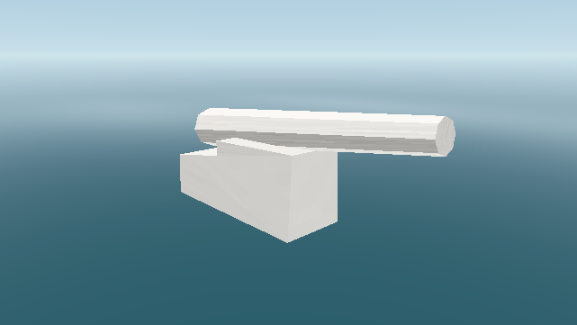

# Original asset inspection

The first local resource sample is from Sea Dogs: To Each His Own. Resources
remain outside Git; only the inspection code and these results are published.
The collection scan below records metadata compatibility. Native rendering
evidence is limited to the explicitly listed model samples.

## First native ship preview, 2026-10-17

The new full static readers and preview were exercised on
`MODELS/Ships/Barkentine1/barkentine1.gm` and its children, using original local
resources outside Git:

- 20 GM 1.05 files, 32 draw meshes, 8,055 triangles.
- Three decoded original TX textures; ten curved static four-corner sails.
- Native Metal on AMD Radeon Pro 555X, macOS 15.7.8 Intel.
- 1280 x 720 offscreen PNG and three successfully presented native window frames.

The image uses new lighting and diagnostic water. It does not establish ship
physics, original rigging/material behavior, collision, or gameplay support.
The test suite also decodes the upstream cannon and rasterizes it with a red
test texture, including a geometric-normal fallback for its zero vertex normals.
Commercial assets and the ship capture are not committed. The results below
remain header-only checks across the collection; they do not imply full decoding
of every resource.

The upstream cannon fixture rendered in Linux CI through software Vulkan
(Mesa llvmpipe), with a plain white material and the new preview water:



The [CI run for preview commit 096c2519](https://github.com/STG-44/storm-engine/actions/runs/39006901573)
passed on all four platforms. Each job runs 11 CPU tests, decodes the upstream
cannon, and builds the inspector and preview. Linux also passes both GPU tests,
PNG readback, and three native window frames for each scene on software Vulkan.
Windows and hosted macOS jobs establish compilation/CPU compatibility; they do
not establish physical GPU compatibility. The original ship was tested locally
on Metal, separately from the redistributable CI fixture.

## Rust header scan, 2026-10-17

```sh
cargo run -p storm-formats --locked -- scan /path/to/game/RESOURCE
```

| Resource | Result |
| --- | --- |
| GM files encountered | 4,136 |
| GM 1.05 headers accepted | 4,129 |
| Triangles declared by accepted GM headers | 23,705,727 |
| TX headers accepted | 5,732 |
| TX header failures | 0 |

The source archive contains 5,724 TX files. Its copy recipe produces 79
additional textures, of which eight match the final manifests directly. The
other 71 are intermediate loading images that still need the installer's
RTPatch reconstruction. Those generated copies are kept outside the resource
directory, rather than treated as validated original assets.

Completeness checks find all 43,398 files from the primary resource and common
music archives. With the eight verified copies, the directory has 43,406 files:
43,405 match a supplied manifest and one local emulator configuration is not
listed in either manifest. Per-path checks allow either supplied language
manifest and handle the legacy Windows-1251 filename. This is a resource sample;
full language/audio/video installation has not been reconstructed.

| TX format | Files |
| --- | --- |
| DXT1 | 2,979 |
| A8R8G8B8 | 949 |
| X8R8G8B8 | 914 |
| R5G6B5 | 308 |
| DXT5 | 255 |
| DXT3 | 192 |
| A4R4G4B4 | 109 |
| A1R5G5B5 | 26 |

Seven GM files are rejected by the current strict reader. Each of these seven
matches its supplied MD5 manifest; they are not extraction mismatches:

| Path relative to RESOURCE | Reason |
| --- | --- |
| `MODELS/big_sky.gm` | GM 1.02; reader currently supports 1.05 |
| `MODELS/sky.gm` | GM 1.02 |
| `MODELS/small_sky.gm` | GM 1.02 |
| `MODELS/light.gm` | GM 1.01 |
| `MODELS/sphere.gm` | GM 1.01 |
| `MODELS/Locations/Incas Temple/Alcove/Alcove_l.gm` | Infinite bounds in a model with no objects |
| `MODELS/Locations/Incas Temple/Labirint/lab1_l.gm` | Declared tables exceed file length by 18 bytes |

The scan therefore exits with status 1 and reports all seven files. Future
decoders must establish the older layouts and an explicit policy for these
locator headers. Passing header inspection does not validate individual
vertices, indices, string references, texture pixels, or BSP records.

The test suite uses the cannon mesh already present in the upstream repository,
plus malformed binary headers. Commercial assets are not required for CI.

The [CI run for inspector commit ca6a70b6](https://github.com/STG-44/storm-engine/actions/runs/39004859635)
passed on Ubuntu 24.04, Windows 2025, macOS 15 Apple Silicon, and macOS 15 Intel.
Each job builds the native inspector, runs the CPU format tests, and inspects
the upstream cannon through its CLI. The existing Linux Vulkan checks also
remain green. These checks do not establish original-game rendering support.
