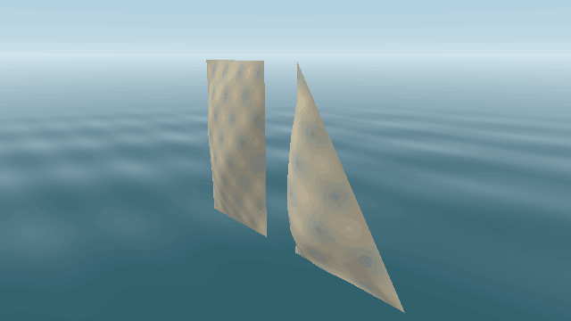

# Wind and sail preview

The Rust preview now constructs triangular and four-corner sails from original
GM locators, and deforms them each frame under adjustable wind. This is new
kinematic preview code; the original rigging simulation and ship forces have
not been ported.



Native Metal captures of the procedural fixture at 24 wind directions, 16 m/s,
fixed time 0. Only the wind parameter changes; the edges remain attached. The
GIF assembles the application's PNG captures, without game resources.

## Run without game resources

```sh
cargo run -p storm-demo --locked -- --sail-demo --wind-speed 16
cargo run -p storm-demo --locked -- --sail-demo --wind-speed 0 --paused
cargo run -p storm-demo --locked -- --sail-demo --wind-direction -90 --time 2 --headless sails.png
```

The fixture contains one quad, one triangle, and a generated checker texture.
Original ships accept the same wind/time options with `--model` and `--game-dir`.
Space pauses animation; `+`/`-` adjust speed, `,`/`.` change direction. Camera
controls remain active while paused. The native window displays wind/pause
state in its title. Speed is 0–40 m/s. Direction is the direction wind travels
towards, clockwise from +Z to +X. This coordinate system follows the preview's
reflection of Storm's Z axis. The default is 8 m/s towards 45°.

## Original conventions

`SAIL::AddSailLabel` in `src/libs/rigging/src/sail.cpp` selects triangle groups
`sailt`/`sailv` and four-corner groups `sails`/`sailg`/`sailf`/`saild`/`sailx`/
`sailn`. Group suffixes distinguish sails within each host node. Points are read
from `sail1`–`sail3` (triangle) or `sail1`–`sail4` (quad) and transformed through
the geometry hierarchy. Quad labels follow the perimeter; the C++ hard-point
array swaps its last two entries. Triangle UVs follow `SAILONE::SetTexGrid`:
tip `(0,1)`, sail2 `(1,0)`, sail3 `(1,1)`.

Missing or duplicate corners, unsupported sail groups, non-finite values, and
degenerate patches are errors. Rope locators and optional `sail0` limit points
are not cloth corners. Limit-point bulge behavior remains unimplemented.
Square, trapezoidal, heraldic, and special groups currently share the same quad
deformation; their distinct original behavior is not claimed.

## Deformation and boundaries

A quad has 169 vertices/288 triangles; a triangular grid has 91 vertices/144
triangles, without duplicate tip vertices. Wind pressure changes the signed
bulge along the surface normal; a bounded traveling oscillation adds flutter.
Every boundary point is pinned, including the original attachment locators.
Calm wind produces the undeformed surface with no flutter. Reversing wind
reverses inflation. Normals use analytic surface derivatives after deformation.
Time is explicit and repeatable. Pausing excludes paused wall time when resuming.

Only dynamic sail vertex buffers are rewritten on the GPU. Topology, materials,
and static hull buffers are reused. This is a prescribed shape, without mass,
springs, inertia, collisions, rope tension, furling, damage, or propulsion.
Original ship previews continue using `parus_common.tga`; script-selected cloth
textures and heraldry remain pending.

## Validation

On local macOS Intel / AMD Radeon Pro 555X, 15 CPU tests and three explicit Metal
GPU tests pass. CPU tests check surface coverage/winding, finite unit normals,
fixed boundaries, reversed/calm wind, repeatability, original locator/UV order,
parent transforms, malformed input, and pause/resume timing. The new GPU test
reuses one scene across changing times/winds and compares only cloth pixels, so
animated water cannot satisfy the motion assertion.

Barkentine1 loads 20 original GM files, three original TX textures plus the white
fallback, and 12 sails including its two previously omitted triangular jibs:
34 draw meshes, 8,343 total triangles. A 1280 x 720 frame was rendered locally;
commercial assets and that capture stay outside Git. The Linux workflow also
captures the procedural sail fixture and smoke-tests its paused native window.

The [CI run for code commit 83ea00e1](https://github.com/STG-44/storm-engine/actions/runs/39008381018)
passed all four jobs on 2026-10-17: Windows 2025, Ubuntu 24.04, macOS 15 Apple
Silicon, and macOS 15 Intel. All run 15 CPU tests, Clippy, formatting, upstream
fixture decoding, and native builds. Linux also passes all three GPU tests on
Vulkan/Mesa llvmpipe, PNG captures, and three frames in each of the diagnostic,
cannon, and paused sail windows under Xvfb. Executables, inspector binaries, and
the Linux fixture capture are workflow artifacts. Hosted Windows/macOS builds
establish CPU/build compatibility; physical GPU validation is still needed there.
