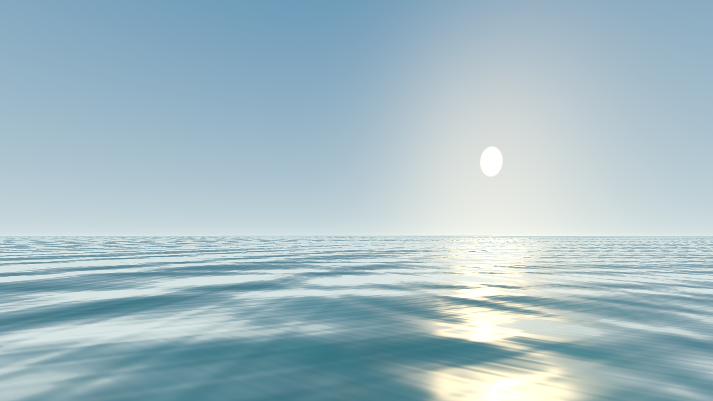

# Storm Rust native model preview

This native application is the first executable part of the Storm Engine Rust
port. It previews original static GM geometry and TX textures using wgpu, or
opens an animated resource-free diagnostic sea. Both can render to a PNG without
a window. An opt-in sailing prototype adds wind drive, water resistance,
rudder control, and damped wave response. Original scripts, full ship physics, and the original sea
simulation have not been ported.

The [entity/message foundation](../docs/RUNTIME_FOUNDATION.md) now connects to
sail damage script handlers. Add `--event-report events.json --shot-owner 7
--ship-character 19` to a model preview or a GPU-free `--rig-report` command to
inspect the original event payloads. Character indices are preview inputs;
original character scripts are not running.
The [attribute tree port](../docs/ATTRIBUTES.md) also reports persistent per-character
sail masks and their reconstruction through the original `ship.sails` layout.

The [first script runtime subset](../docs/SCRIPT_RUNTIME.md) now executes typed
functions, arithmetic, conditions and loops without a GPU. Its separate native
attribute fixture writes and reads sail masks. The preview's damage events now
execute [diagnostic source handlers](../docs/SCRIPT_EVENTS.md);
complete original game handlers remain pending.

[Object/ref/aref support](../docs/SCRIPT_OBJECTS.md) also executes original
attribute syntax and internal attribute functions, with real entity notifications:

```sh
cargo run -p storm-script --locked -- rust/crates/storm-script/fixtures/ship_attributes.c --report ship-script-state.json
```

```sh
cargo run -p storm-script --locked -- rust/crates/storm-script/fixtures/sail_damage.c --report script-state.json
```



## Run

Install Rust through [rustup](https://rustup.rs/). Run these commands from the
repository root. `rust-toolchain.toml` pins the compiler and required components;
`Cargo.lock` pins dependency versions.

```sh
cargo run -p storm-demo --locked
cargo run -p storm-demo --locked -- --gpu-info
cargo run -p storm-demo --locked -- --headless first-frame.png
```

The window closes with Escape or its close button. Its title identifies the
selected adapter and graphics API. Resize, minimization, surface recovery, and
resume are handled by the native event loop. A smoke run exits after three
presented frames:

```sh
cargo run -p storm-demo --locked -- --frames 3
```

`--backend auto` allows native Metal, Vulkan, and DirectX 12 implementations.
Use `--backend metal`, `--backend vulkan`, or `--backend dx12` to require a
specific API. An unavailable API is reported as an error. Windows
and Linux builds need a compatible GPU driver. macOS uses Metal directly.

The first local check passed on macOS 15.7.8 / Intel with a Radeon Pro 555X:
Metal offscreen readback and animation tests, and three frames presented in a
native window. The original Barkentine1 ship also renders through Metal, including
20 geometry files, three original textures, and twelve locator-generated sails
(two triangular, 8,343 total scene triangles). The new preview cloth responds to
wind; full game support is pending.

Linux needs the X11/Wayland development packages when compiling. On Ubuntu:

```sh
sudo apt-get install libxkbcommon-dev libxkbcommon-x11-dev libwayland-dev libx11-dev libxi-dev libxrandr-dev libxcursor-dev
```

For software rendering on Linux, install `libvulkan1 mesa-vulkan-drivers`.

## Validate

```sh
cargo fmt --all --check
cargo clippy --workspace --all-targets --locked -- -D warnings
cargo test --workspace --locked
cargo test -p storm-render --locked -- --ignored
```

CPU tests validate all three WGSL shaders, static geometry references, texture
decoding/mips, and malformed input. The explicitly ignored GPU tests check sea
animation, row padding, invalid frame/camera parameters, and rasterization of the
upstream cannon fixture with a red test texture. The model test also checks that
camera movement changes the image and handles the fixture's zero normals. The
sail test checks both topologies and persistent GPU buffer updates, excluding
animated water when comparing cloth pixels. Calm cloth stays motionless.
CPU sailing tests cover dynamics, helm, frame partition, and long runs; the
rigid-pose GPU test checks translation, yaw, heave, pitch and roll with a fixed
camera. Two more GPU tests compare CPU/WGSL wave heights and gradients, and
check that displaced water depth hides a submerged plate and reveals it in a trough.
One checks gathering/unfurling both sail topologies in one persistent scene,
including stationary bundled cloth and restoration of the full rig. Another
checks the original intermediate set: normal sails stay full, full-only sails gather.
They require a native graphics adapter or a software Vulkan implementation.

The Rust workflow builds and runs CPU checks on Linux, Windows, macOS Apple
Silicon, and macOS Intel. Linux also runs all explicit GPU tests with software Vulkan,
captures the diagnostic, upstream cannon, and procedural sails, and opens all
three scenes under Xvfb (sails start paused).
It also captures a sailing transform and state JSON using the upstream cannon
fixture and opens that fixture in sailing mode under Xvfb. A separate wave case
uses a 0.15 m envelope suitable for the small fixture and exports hull motion.
A gathering fixture capture and rig-state JSON check exercise partial deployment.
Hosted macOS/Windows builds alone do not establish
GPU or gameplay compatibility; physical-device checks remain necessary.

The [preview CI run for code commit 096c2519](https://github.com/STG-44/storm-engine/actions/runs/39006901573)
passed all four jobs. [Validation details and the Vulkan fixture capture](../docs/ASSET_VALIDATION.md#first-native-ship-preview-2026-10-17)
record the tested scenes and limits.

The inherited C++ workflows do not run on pushes or pull requests targeting
`rust-port`; the Rust workflow owns checks on that integration branch. The
original C++ workflows remain available on other branches.

## Original game resources

Keep the complete game installation outside Git, or use the ignored `game-data/`
directory. The diagnostic and upstream cannon fixture need no game installation.
To preview the original barquentine, replace `/path/to/game` with your local
installation (or pass its RESOURCE directory to `--game-dir`):

```sh
cargo run -p storm-demo --locked -- \
  --model /path/to/game/RESOURCE/MODELS/Ships/Barkentine1/barkentine1.gm \
  --game-dir /path/to/game
```

Drag with the left mouse button or use the arrow keys to orbit. Scroll to zoom,
press R to reset, and Escape to close. Add `--headless barkentine.png --time 0`
for a deterministic capture, or `--yaw 90` for another initial angle.

Space pauses/resumes animation while the camera remains usable. `+`/`-` change
wind speed; `,`/`.` rotate the wind in 15-degree increments. The title displays
wind and pause state. Initial settings: `--wind-speed 12 --wind-direction 45`;
speed is 0–40 m/s and direction points towards +Z at 0°, +X at 90°. `--paused`
starts a native window paused at `--time` (default 0). Captures always use exactly
the requested time; pause excludes elapsed wall time when resuming.

Child models follow the original `geometry` locators and filename convention.
`sailt`/`sailv` groups produce triangular cloth; `sails`/`sailg`/`sailf`/`saild`/
`sailx`/`sailn` groups produce four-corner cloth. Shape changes use new,
deterministic kinematic code, with every boundary point pinned and normals
recomputed each frame. Locator-built ropes, shrouds and flags are implemented;
original rigging dynamics and ship physics beyond the new
sailing/wave prototype remain pending. The water is a new
preview shader. Materials use the first base texture and new lighting, without
COL lighting, normal maps, or original material effects.

Texture paths resolve case-insensitively on every OS. The default ship skin is
Hull1. Use `--texture-dir Ships/Barkentine1/Hull2` to choose another skin, and
`--single-mesh` to disable children and generated sails. Missing or ambiguous
textures are errors. For a model without game resources:

```sh
cargo run -p storm-demo --locked -- \
  --model tools/modding-tool/Meshes/cannon_x.gm --untextured
cargo run -p storm-demo --locked -- --sail-demo --wind-speed 16
```

The procedural sail demo contains one quad and one triangle with a generated
checker texture. It needs no game resources. See [the sail implementation and
validation scope](../docs/SAIL_PREVIEW.md).

## Sail the original model

Add `--sail` to the original model command to enable approximate dynamics.
Hold A/D for rudder and use W/S to request sail deployment. Releasing the rudder or
losing focus centres it; physical keys work with any keyboard layout. Space
pauses motion and cloth while camera controls remain available. The title shows
speed in knots and course. The camera follows position as the hull turns.

For a reproducible turn, add `--sail --wind-speed 12 --wind-direction 180
--heading 180 --rudder 0.6 --time 40 --headless sailing.png --state-json state.json`.
The interval is replayed from rest with constant controls. The new CPU model
includes apparent wind, leeway, water resistance, yaw damping, and a 120 Hz step.
The hull now heaves, pitches and rolls on a shared CPU/GPU wave surface. Sailing
defaults to a 1.5 m envelope; `--wave-height 0` restores flat water. Try
`--wave-height 3 --wave-direction 115` for a rougher cross sea. The camera keeps
a level horizon. See [wave controls, model and validation](../docs/WAVE_RESPONSE.md).
Sails gather/unfurl over time and drive follows actual deployment. A full change
takes four seconds. `--sail-setting` sets the initial fraction; `--sail-target`
requests a new one during replay. The title shows actual and requested fractions.
See [sail gathering details](../docs/SAIL_FURLING.md). Individual sail commands,
original furling, horizontal wave forces, collisions and original game balance
remain pending. See [sailing details](../docs/SAILING_PROTOTYPE.md).

The `storm-formats` crate provides header inspection and full static render-data
decoding through the native `storm-assets` tool:

```sh
cargo run -p storm-formats --locked -- inspect tools/modding-tool/Meshes/cannon_x.gm
cargo run -p storm-formats --locked -- inspect /path/to/game/RESOURCE/Textures/example.tga.tx
cargo run -p storm-formats --locked -- scan /path/to/game/RESOURCE
cargo run -p storm-formats --locked -- decode tools/modding-tool/Meshes/cannon_x.gm
cargo run -p storm-formats --locked -- decode /path/to/game/RESOURCE/Textures/example.tga.tx
```

Inspection reports GM object/material/triangle counts, bounds, and vertex-buffer
counts; TX dimensions, mip count, pixel format, palette/cubemap flags, and base-mip
size. Scan checks headers and minimum table lengths, skips symbolic links, prints
JSON, and exits unsuccessfully if any inspected file fails. It preserves unknown
TX format codes for future decoders. It reads at most 72 bytes per asset.

`decode` reads the full file (256 MiB input limit), validates static GM 1.05
buffers/types 0–4, local indices, material/texture/name references, finite render
values, and declared BSP byte/index ranges. Two-bone GM buffers (kind 4) and float-quaternion AN animation are supported for
the crew preview. Collision traversal remains pending. Unknown older GM versions remain errors.

TX decoding validates every declared mip and supports DXT1–5, A8R8G8B8,
X8R8G8B8, R5G6B5, A1R5G5B5, A4R4G4B4, and L8, producing portable RGBA8 with a
256 MiB decoded budget. Palette, cubemap, unknown flags/formats, and partial
compressed blocks are explicit errors. The preview limits assembled scenes to
512 MiB, 256 nodes, and 16 levels. Header-only `scan` results are separate from
these full decoding checks; the whole resource collection has not been fully
decoded. No commercial assets or captures are bundled in the repository or CI.

Original controls now select three sets (0 / 0.5 / 1), with generic per-sail
classification from GM node/parent names. [Rules and the 40-model audit](../docs/ORIGINAL_SAIL_MODES.md).

[Rigging preview](../docs/RIGGING_PREVIEW.md) adds locator-built ropes and
shrouds plus wind-driven flags. Run `--rigging-demo` without game resources.
The tested original ship loads its rigging textures/atlas settings from
`RESOURCE/INI/rigging.ini`. [Ship flag selection](../docs/FLAG_SELECTION.md)
adds `--flag-nation`, `--flag-role`, `--surrendered` and `--pirate-flag` with
physical F/G/H/J controls. Character lookup and script execution remain pending.


[Ship crew and damage](../docs/SHIP_PRESENTATION.md) adds original animated
sailors and deck paths, fireplace flame/smoke, falling mast groups, detachable
hull sections and persistent 10/12-sector sail holes. Use `--ship-demo` for a
resource-free scene. `--sail-volley 3` sends reproducible test shots and reduces
sailing drive. C/B/M/P/X/0 control crew, fire, masts, hull pieces, a camera-centre
test shot and preview restoration. `--crew 12 --deck-view` focuses an original
ship's deck. Full battle/crew AI and projectile ballistics remain pending.


[Original sail damage](../docs/ORIGINAL_SAIL_DAMAGE.md) now uses the supplied
`Ships/parus_hole.tga.tx` rather than procedural cutouts. The original texture
coordinates, wrap/mirror addressing, alpha test, full-resolution sector index
ranges and coarse collision rules are preserved. Metadata reports the mask
source and `[SAILS]` damage coefficients. A missing original mask is an error.

### Nested and timed script events

The [frame-driven scheduler](../docs/SCHEDULED_EVENTS.md) supports Event,
PostEvent and ClearPostEvents with checked l/f/s payloads. Native preview frames
advance it while unpaused. A deterministic GPU-free fixture runs with:

```sh
cargo run -p storm-script --locked -- rust/crates/storm-script/fixtures/timed_events.c --frame-ms 0,9,1,0 --report timed-script-state.json
```

It produces four completed handlers and four entity attribute notifications;
the two queued events fire on the third and fourth supplied frames.

### Persistent script globals and arrays

[Global declarations and one-dimensional arrays](../docs/SCRIPT_GLOBALS.md)
include `Characters[i].ship` syntax, checked element references and array resizing.
`Runtime` retains them between calls and events; `Program::call` starts fresh.

```sh
cargo run -p storm-script --locked -- rust/crates/storm-script/fixtures/global_ships.c --frame-ms 0,0 --report global-script-state.json
```

This new diagnostic stores two characters' sail masks and counts six holes, then
writes the visible ship on the second supplied frame: three entity notifications.
It does not execute commercial game programs.

### Multi-file script sources

[Source loading](../docs/SCRIPT_SOURCES.md) supports typed `#define` constants
and `#include` files in Storm's append order. The default root is the entry
file's directory; `--script-root` makes the entry path relative to an explicit
program directory. Windows separators and ASCII case variants work on each host.

```sh
cargo run -p storm-script --locked -- rust/crates/storm-script/fixtures/multi_ship/Main.c --frame-ms 0,0 --report multi-script-state.json
```

The four-file diagnostic reproduces the earlier global-character report and
adds normalized file names in `script_sources`. It includes duplicate/cyclic
paths, constants for array dimensions and event names, and a later-frame commit.

### Static event handlers

[`#event_handler`](../docs/STATIC_EVENT_HANDLERS.md) registers handlers during
compilation, including in uncalled functions. The static four-file diagnostic
produces the same complete report as `multi_ship` without dynamic registrations:

```sh
cargo run -p storm-script --locked -- --script-root rust/crates/storm-script/fixtures/static_ship MAIN.C --frame-ms 0,0 --report static-script-state.json
```

Deleted static entries retain their original flag and can be reactivated. A
confirmed infinite cleanup loop in the original returns an explicit Rust error.

[`ClearEvents`](../docs/CLEAR_EVENTS.md) removes dynamic handlers using original
cleanup rules while retaining static flags, globals and queued messages.
Run the same fixture with `--entry ClearMain` to verify that a queued static
commit survives and an unwanted dynamic ship handler stays inactive:

```sh
cargo run -p storm-script --locked -- --script-root rust/crates/storm-script/fixtures/static_ship MAIN.C --entry ClearMain --frame-ms 0,0 --report clear-script-state.json
```

[`IsEntity`, `DeleteClass` and `EntityUpdate`](../docs/ENTITY_SCRIPT_API.md) now
connect scripts to native entity lookup/deferred deletion and persistent control
over attribute notifications. The diagnostic exercises them across a posted
event and keeps the complete report without commercial resources:

```sh
cargo run -p storm-script --locked -- rust/crates/storm-script/fixtures/entity_lifecycle.c --frame-ms 0,0 --report entity-script-state.json
```

[Registered factories and Init](../docs/ENTITY_CREATION.md) now back the original
`CreateEntity`/`CreateClass` source calls. The new diagnostic binds a persistent
tree through ref, checks a rejected replacement, creates an entity with no
attribute binding and deletes the previous identities:

```sh
cargo run -p storm-script --locked -- rust/crates/storm-script/fixtures/entity_creation.c --report creation-script-state.json
```

The registered observer/reject classes are diagnostic fixtures. Original game
classes remain pending. The next [message binding](../docs/ENTITY_MESSAGES.md)
supports synchronous `SendMessage` and opaque 64-bit `ptr` values.

[Original address expressions](../docs/ADDRESS_REFERENCES.md) now support
`CreateEntity(&ship, class)` and `&array[index]`. The same creation scenario
with `--entry AddressMain` produces an identical complete report:

```sh
cargo run -p storm-script --locked -- rust/crates/storm-script/fixtures/entity_creation.c --entry AddressMain --report address-script-state.json
```

### Native entity messages

The first two original SHIP sail commands also drive the preview simulation.
Run the resource-free startup source and export its state without a GPU:

```sh
cargo run -p storm-demo --locked -- --sail-demo --sail \
  --wind-speed 0 --wind-direction 0 --wave-height 0 \
  --sail-script rust/apps/storm-demo/fixtures/ship_sails.c \
  --sail-script-report ship-sails-script-state.json
```

Omit `--sail-script-report` to open a native window with that state. This ports
`50305`/`50325` only; the adapter is not a complete original SHIP class. See
[native sail-command scope](../docs/SHIP_SAIL_MESSAGES.md).

```sh
cargo run -p storm-script --locked -- \
  rust/crates/storm-script/fixtures/entity_messages.c \
  --report message-script-state.json
```

This resource-free diagnostic creates a native test entity, sends `lfsiap`
fields, echoes a 64-bit result through a `p` field and verifies zero after
pending deletion. The original commercial classes/message codes remain
unfinished. See [formats, pointer scope and reference checks](../docs/ENTITY_MESSAGES.md).

The [native variable binding](../docs/SCRIPT_VARIABLE_MESSAGES.md) adds `e`
output parameters, exact scalar reads/setters, array element handles and
checked local/global/temporary lifetimes. Run its resource-free diagnostic:

```sh
cargo run -p storm-script --locked -- \
  rust/crates/storm-script/fixtures/variable_messages.c \
  --report variable-script-state.json
```
